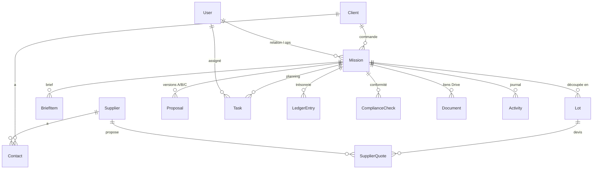

# WINDCHIC Ops — back-office interne

Plateforme de pilotage : **demande entrante → brief → sourcing & devis → chiffrage & marge → proposition A/B/C → exécution → clôture financière**.

> ⚠️ Ce dossier vit provisoirement dans le dépôt public du site. **Aucune donnée réelle n'y est commitée** : les données d'import (`data/import.local.json`) et la base (`*.db`) sont ignorées par git. À déplacer dans un dépôt **privé** `windchic-ops` avant toute mise en production.

## Démarrer en local

```bash
cd windchic-ops
npm install
cp .env.example .env
npm run db:reset
npm run dev
```

Ouvrir http://localhost:3000. Comptes : `theo@windchic.com` (Direction) et `wenjing@windchic.com` (Partenaire). Mot de passe : `windchic-demo` (ou `SEED_PASSWORD`).

```bash
npm test
```

Cette commande lance les tests du moteur financier et des verrous (3 modèles de facturation, provision, apporteur).

---

## 1. Cahier des charges fonctionnel (MVP)

### Rôles et droits

| Fonction | Direction (ADMIN) | Chef de projet (PM) | Partenaire (PARTNER) |
|---|:-:|:-:|:-:|
| Missions, brief, planning, journal | ✅ | ✅ | ✅ |
| Voir l'identité des fournisseurs | ✅ | ✅ | ❌ (codes SUP-xxx) |
| Voir coûts, marges, KPI financiers | ✅ | ✅ | ❌ |
| Saisir la trésorerie | ✅ | ❌ | ❌ |
| Forcer un verrou de statut | ✅ | ❌ | ❌ |

### Modules

1. **Cockpit** : urgences (critique, J-3, action en retard), demandes à qualifier, devis fournisseurs sans réponse depuis plus de 48 h, pipeline Kanban, mes actions à 7 jours, CA signé + pipeline pondéré, marge nette signée, conversion, rentabilité par mission.
2. **Missions / CRM** : saisie en 60 s, code `WC-AAAA-NNN`, 3 modèles de facturation (Refacturation, Honoraires + provision, Apporteur), 8 statuts, urgence, compte à rebours J.
3. **Brief** : 18 questions standard (issues du « Modèle brief ») avec statut ❓/⚠️/✅, note interne et génération de la liste de questions à envoyer au client.
4. **Lots & devis (SRM)** : découpage en lots, consultation de N fournisseurs suggérés (catégorie + score), email RFQ pré-rédigé en copie cachée, saisie des devis, conformité, sélection, prix de vente calculé ou forcé, contrôle du plancher de marge et du budget plafond.
5. **Proposition** : options A/B/C **anonymisées** triées par prix, version figée, FR / EN / 中文, impression PDF, statut envoyée / acceptée / refusée.
6. **Planning** : rétroplanning généré depuis J / Fin / L (modèles Coordination, Stand, Communication, RDV, Conciergerie, Sourcing), timeline, statut en un clic.
7. **Finances** : journal de trésorerie typé, solde courant, rapprochement de provision (trop-perçu à restituer), mouvements « simulation » exclus des calculs.
8. **Conformité** : check-list par modèle et par type (mandat, factures au nom du client, Code du tourisme…). Un point *BLOQUANT* verrouille l'exécution.
9. **Documents & journal** : liens Drive typés, décisions client consignées.

### Verrous métier (`src/lib/rules.ts`)

| Vers | Condition |
|---|---|
| Sourcing & chiffrage | Brief exploitable (au plus 40 % de questions ouvertes) |
| Devis envoyé | Chaque lot a une option retenue, honoraires saisis (modèle A), taux de marque ≥ 15 % (modèle B) |
| Validée | Une proposition acceptée |
| En cours | Acompte encaissé, aucun point de conformité bloquant |
| Terminée | Provision soldée (modèle A), check-list clôturée |

## 2. Architecture

- **Next.js 15** (App Router, Server Components, Server Actions) : une seule application, pas d'API à maintenir.
- **Prisma 6**, avec **SQLite** en développement et **PostgreSQL (Supabase)** en production. Il suffit de changer `provider` dans `prisma/schema.prisma`.
- **Tailwind CSS 4** avec la charte du site (marine `#0b1420`, crème, or `#c6a16b`, DM Sans + Cormorant).
- Authentification par session signée HMAC (cookie httpOnly) et matrice de droits dans `src/lib/auth.ts`.
- Google Drive reste le stockage des fichiers : la base ne contient que des liens.

```
src/
  app/(app)/            pages connectées (cockpit, missions, tâches, prestataires, clients, propositions)
  app/actions.ts        toutes les mutations (server actions)
  lib/finance.ts        moteur de marge et de trésorerie (fonctions pures, testées)
  lib/rules.ts          verrous de statut
  lib/templates.ts      modèles brief / rétroplanning / conformité
prisma/schema.prisma    modèle de données
prisma/seed.ts          import (data/import.local.json sinon data/demo.json)
```

### Modèle de données



## 3. Plan de développement

| Sprint | Contenu | État |
|---|---|---|
| S1 : Cœur | Missions, brief, lots/devis, marge sur 3 modèles, proposition A/B/C, Kanban, cockpit, rôles | ✅ livré (v0.1) |
| S2 : Exécution & finance | Rétroplanning, trésorerie, rapprochement provision, conformité et verrous | ✅ livré (v0.1) |
| S3 : Mise en production | Dépôt privé, Supabase Postgres, Vercel, vrais mots de passe, sauvegardes | ⏳ besoin de vos comptes |
| S4 : Automatisation | Brief quotidien planifié, brouillons Gmail RFQ, extraction des devis PDF, création auto des dossiers Drive, synchro Calendar | ⏳ |
| S5 : Prospection | Fusion des 4 bases de prospects, module Prospects → Mission, interface 中文 complète | ⏳ |
| S6 : Portails | Portail client (validation de proposition, documents), synchro Qonto | Seulement si plus de 3 demandes par mois |

## 4. Mise en production

1. Créer un dépôt GitHub privé `windchic-ops` et y déplacer ce dossier.
2. Créer un projet Supabase et passer `provider = "postgresql"`. Renseigner `DATABASE_URL`, puis lancer `npx prisma db push`.
3. Importer le projet sur Vercel avec `DATABASE_URL` et `SESSION_SECRET` (32 caractères aléatoires).
4. Lancer le seed avec `SEED_PASSWORD` fort, puis changer les mots de passe.

## Limites connues (v0.1)

- Les montants sont stockés en `Float` et arrondis au centime dans les calculs. Il faudra passer en `Decimal` sur Postgres.
- Pas encore de gestion des utilisateurs dans l'interface (création via le seed).
- La conversion de devises n'est pas gérée (tout est en EUR).
- La check-list de conformité est un aide-mémoire : elle ne remplace pas l'avis d'un expert-comptable ou d'un juriste.
